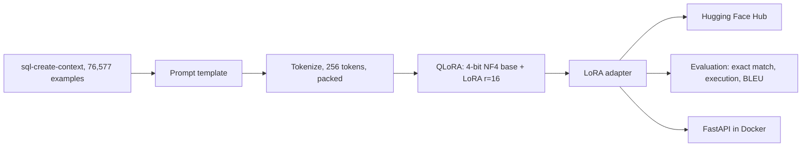

# QueryCraft

[](https://github.com/Siddhesh-Ai9797/querycraft/actions/workflows/ci.yml)

Phi-3 Mini fine tuned to turn plain English questions into SQL. Using QLoRA, I trained only 0.23% of the model's parameters on one 8 GB consumer GPU in about 3 hours. Exact match accuracy went from 0% to 82%. The model is published on Hugging Face and served through a FastAPI endpoint in Docker.

This is the model behind [QueryCraft Enterprise](https://github.com/Siddhesh-Ai9797/querycraft-enterprise), the multi agent platform that adds table search, SQL safety checks and monitoring.

## Results

Evaluated on 50 held out examples the model never saw in training.

| Metric | Base Phi-3 Mini | Fine tuned | Change |
|---|---|---|---|
| Exact match | 0.0% | **82.0%** | +82 points |
| Execution accuracy | 84.0% | **96.0%** | +12 points |
| BLEU | 55.79 | **96.42** | +40.6 |

Exact match checks that the SQL text matches the answer after normalizing case and spaces. Execution accuracy checks that the SQL actually runs against the given schema in SQLite.

## How it works



1. **Format.** Each example has a question, a CREATE TABLE schema and the answer SQL. They are put into one instruction style prompt.
2. **Quantize.** The 3.8B base model loads in 4-bit NF4 with double quantization, so it fits in 8 GB of GPU memory.
3. **Train adapters.** LoRA adapters with rank 16 and alpha 32 are added to the attention and feed forward layers. Only these 8.9M parameters train, for one epoch with an effective batch size of 16.
4. **Evaluate.** The same harness runs the base and tuned models on held out examples and compares exact match, execution accuracy and BLEU.
5. **Serve.** FastAPI loads the base model plus the adapter. A mock mode lets the API and its tests run without a GPU.

## Model

| Property | Value |
|---|---|
| Base model | microsoft/Phi-3-mini-4k-instruct, 3.8B |
| Method | QLoRA, 4-bit NF4 with LoRA rank 16 |
| Trainable parameters | 8,912,896, which is 0.23% of the model |
| Dataset | b-mc2/sql-create-context, 76,577 examples |
| Hardware | NVIDIA RTX 5060 Ti, 8 GB |
| Training time | 3 hours 2 minutes |
| Final training loss | 0.5677 |

Adapter weights: **[Sid9797/querycraft-phi3-sql](https://huggingface.co/Sid9797/querycraft-phi3-sql)**

## Tech stack

| Area | Tools |
|---|---|
| Training | PyTorch, Transformers, PEFT, TRL, bitsandbytes |
| Evaluation | SQLite execution checks, BLEU |
| Serving | FastAPI, Pydantic, Docker, Streamlit demo |
| MLOps | Hugging Face Hub, GitHub Actions, Ruff, pytest |

## Project structure

```
src/
  data/          Dataset loading, prompt template, tokenizer setup
  training/      QLoRA config, model loading, trainer
  evaluation/    Exact match, execution accuracy and BLEU harness
  serving/       FastAPI app and inference with a mock mode
scripts/         Train, evaluate and upload to Hugging Face
demo/            Streamlit demo
tests/           API tests that run without a GPU
```

## Running it

```bash
pip install -r requirements.txt
uvicorn src.serving.app:app --port 8000
```

Then open http://localhost:8000/docs.

```bash
curl -X POST http://localhost:8000/generate \
  -H "Content-Type: application/json" \
  -d '{"question": "What is the average salary by department?",
       "context": "CREATE TABLE employees (id INTEGER, name VARCHAR, department VARCHAR, salary FLOAT)"}'
```

The response holds the generated `sql` along with the question and schema you sent.

Without a GPU, use mock mode in Docker:

```bash
docker build -t querycraft .
docker run -e MOCK_MODEL=true -p 8000:8000 querycraft
```

To retrain and evaluate:

```bash
python scripts/train.py
python scripts/run_eval.py
```

## Tests

```bash
MOCK_MODEL=true PYTHONPATH=. pytest tests/ -v
```

GitHub Actions lints with Ruff, runs the tests in mock mode, then builds the Docker image and checks that `/health` responds.

## Author

Siddhesh Patil, MS in Artificial Intelligence, DePaul University
